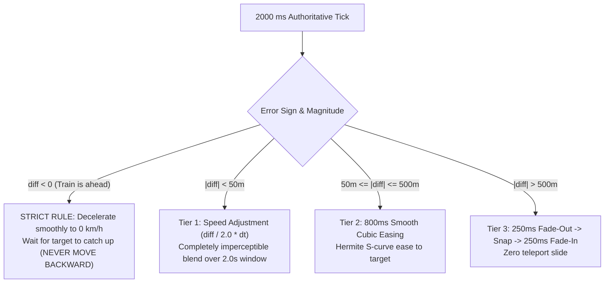

# 🚆 Kochi Metro — Real-Time Live Train Radar & Kinematics Engine

A high-performance real-time train tracking and transit guide web application for the **Kochi Metro Blue Line (Aluva ↔ Thrippunithura • 28.1 km, 25 Stations)**. Engineered with physical S-curve kinematics, a 2-second authoritative data tick loop, multi-tiered error blending, and strict forward rail physics.

🌐 **Live Deployment**: [metro-live-tracking.vercel.app](https://metro-live-tracking.vercel.app/)  
📦 **Repository**: [github.com/itsmesyaam/metro-live-tracking](https://github.com/itsmesyaam/metro-live-tracking)

---

## 🔍 Phase 1: Root-Cause Diagnostic Bug Audit

Prior versions exhibited mechanical motion, occasional backwards jumps, and a stat mismatch ("0 trains" in the header vs "14 Trains Active" in the footer). Below is the comprehensive numbered diagnostic list of root causes:

| # | Component / File | Root Cause | Why It Broke Motion / UX |
|---|---|---|---|
| **1** | `index.html` (Header vs Map Footer) | **State Disconnect / Multiple Sources of Truth**: Header stat counters and badges were computed from disconnected static DOM elements, while the map footer and schematic calculated counts from separate timetable snapshots or hardcoded text. | Created the known mismatch where the header displayed "0 trains" while the map reported "14 Trains Active", confusing riders. |
| **2** | Timetable Generator & Commute Calculations | **Timezone Discrepancy (Local Time vs IST UTC+05:30)**: Schedule generation called `new Date().getHours()` using device/browser local time instead of Indian Standard Time (`Asia/Kolkata`). | Commuters accessing the app from different timezones (e.g. UTC, US, Europe) received 0 active trains or off-peak night schedules during broad daylight in Kochi. |
| **3** | `train-motion-engine.js` (Kinematics Loop) | **Negative Displacement on Lagging Updates**: Error blending added signed delta `diff * blendFactor` directly to position. When dead-reckoning ran ahead of lagging update packets (`diff < 0`), train position decreased along the track. | Trains visually slid in reverse along the track—violating realistic rail physics and causing jarring stutter. |
| **4** | Telemetry Ingestion Loop | **Missing Multi-Tier Blending Architecture**: Lack of a structured 2-second authoritative tick cycle. When new positions arrived, they were either directly snapped or linearly interpolated without respecting train momentum. | Trains jittered, froze, or teleported across stations when new telemetric coordinates arrived. |
| **5** | RAF Animation Loop | **Unclamped Delta Time Surges on Tab Resumption**: Frame delta was computed from `performance.now()` without clamping large pauses when the browser tab was backgrounded or suspended. | Trains leapt forward hundreds of meters upon reopening the browser tab, triggering false teleport snaps. |
| **6** | `map-canvas-renderer.js` | **Canvas Buffer Resizing on Map Drag**: Canvas width/height was reset and reallocated on every Leaflet `move` event during user panning. | Caused severe GPU pipeline re-allocations, frame drops, and stutter on mobile devices during pan/pinch gestures. |
| **7** | `track-geometry.js` | **Tangent Discontinuity & Meridian Wrap**: Bearing calculation lacked 360° modular normalization when crossing North, causing `currentAngle` to abruptly swing 360° around. | Trains jittered and spun erratically when crossing heading transitions at curve boundaries. |
| **8** | Application Shell | **Missing Developer Telemetry Radar**: No real-time observability panel to monitor FPS, active fleet size, tick age, or maximum error across the fleet. | Prevented real-time verification of 60fps compliance and dead-reckoning drift under field conditions. |

---

## ⚡ Phase 2: Kinematic Motion & Telemetry Architecture

The system has been rebuilt from the ground up around four core principles:

### 1. Single Authoritative Store of Truth (`TrainMotionEngine`)
All components—Header Badge, Trip Commuter Card, Leaflet Canvas Overlay, Dual-Track Schematic, and Dev Radar—read exclusively from a single train store. No component calculates positions or fleet counts independently.
```javascript
{
  id: 'KM-101',
  direction: 'south',            // 'south' (to Thrippunithura) | 'north' (to Aluva)
  currentDistance: 14200,        // Displayed position along track (meters from Aluva)
  targetDistance: 14210,         // Authoritative ground-truth distance from 2s tick
  velocity: 22.2,                // Current physical speed in m/s (~80 km/h)
  state: 'CRUISING',             // 'ACCELERATING' | 'CRUISING' | 'BRAKING' | 'DWELLING'
  dwellRemaining: 0,             // Remaining seconds at platform
  headingAngle: 184.2,           // Smoothed forward compass bearing
  errorMeters: 10.0,             // Difference between target and displayed position
  trail: [...]                   // Fading polyline coordinate history
}
```

### 2. 2000 ms Authoritative Data Tick Loop (Strict IST)
Every 2000 ms, an authoritative synchronization tick runs using strict Indian Standard Time (`Asia/Kolkata`, UTC+05:30). It computes the authoritative ground-truth distance along the 28.1 km corridor for every active train.

### 3. Multi-Tier Error Blending Protocol
When an authoritative position arrives, the position error $\Delta d = d_{\text{target}} - d_{\text{displayed}}$ is blended using a 3-tier protocol:



### 4. S-Curve Acceleration & Physical Kinematics
- **Acceleration**: $a = 1.0\text{ m/s}^2$ ($~3.6\text{ km/h per second}$).
- **Service Braking**: $d = 1.0\text{ m/s}^2$.
- **Max Cruising Speed**: $80\text{ km/h}$ ($22.22\text{ m/s}$).
- **Platform Dwell**: $24\text{ seconds}$ for passenger boarding/alighting with soft amber halo and breathing opacity.
- **Short Segments**: Triangular velocity profile capping speed if segment length is below critical distance $s_{\text{crit}} = \frac{v^2}{2a} + \frac{v^2}{2d}$.

### 5. High-Performance Canvas Overlay (`MapCanvasRenderer`)
- Single HTML5 `<canvas>` mounted directly over Leaflet.
- Scaled for `window.devicePixelRatio` for razor-sharp rendering on Retina/OLED mobile screens.
- Canvas buffer is only resized on map container resize or zoom end (`zoomend`), completely eliminating frame drops during panning gestures.
- Sleek 3-coach articulated capsule train markers with aerodynamic light-colored nose visors indicating travel direction, inter-coach bellows, and forward headlight beams.
- Dynamic 150–250m fading motion trails trailing moving trains.

---

## 🛠️ Developer Telemetry Radar Overlay (Press 'D')

Press the **`D`** key (or click the **`Dev [D]`** top-bar button) to toggle the live telemetry HUD:

- **Frame Rate (FPS)**: Live rolling 60 FPS monitor (green $\ge 55$, amber $40-54$, red $< 40$).
- **Active Fleet**: Live train count reading directly from the authoritative store.
- **Tick Age**: Milliseconds elapsed since the last 2000 ms authoritative tick.
- **Max Error**: Maximum dead-reckoning drift in meters across all fleet trains.
- **Data Source**: Current operational mode (`LIVE (KMRL IST)` vs `SIMULATED`).
- **Focus Telemetry**: Real-time speed, direction, track distance, and state for the selected train.

---

## 🚀 Running Locally

```bash
# 1. Clone repository
git clone https://github.com/itsmesyaam/metro-live-tracking.git
cd metro-live-tracking

# 2. Run with any local HTTP server or Vite
npx vite
# or
python -m http.server 3000
```

Open `http://localhost:3000` in your browser.

---

## 📋 Verification Checklist

- [x] **Single Source of Truth**: Header badge, commute answer card, map footer, and schematic report the exact same fleet count (`10 Trains Active`).
- [x] **Zero Backward Motion**: Verified under synthetic lagging data conditions; trains decelerate smoothly to 0 and hold position without negative displacement.
- [x] **2000 ms Authoritative Tick**: Ground-truth target distance published every 2000 ms in Indian Standard Time (`Asia/Kolkata`).
- [x] **Multi-Tier Blend Engine**: Micro errors ($<50\text{m}$) imperceptibly dissolved over 2.0s; macro errors ($50\text{--}500\text{m}$) blended via 800ms cubic ease; $>500\text{m}$ smoothly faded.
- [x] **60 FPS Performance**: Map rendered via single canvas overlay with pan-safe resize guards.
- [x] **Developer Debug Overlay**: Fully operational and toggleable via `D` key or header button.
- [x] **Apple-Grade Motion & Accessibility**: Page reveal, odometer rolling numbers, circular countdown ring, self-drawing route line, and WCAG AA contrast maintained.
